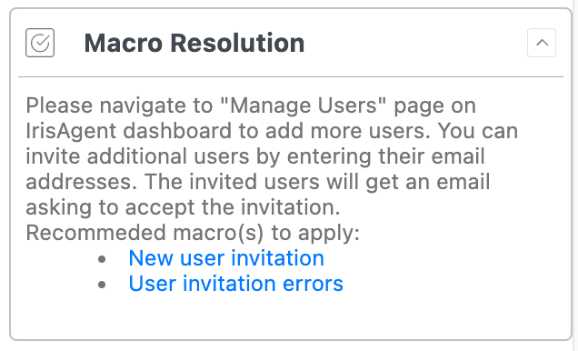
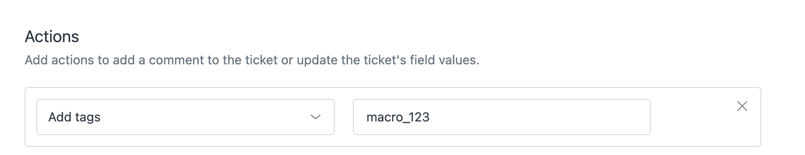

IrisAgent recommends which [Zendesk macro](https://support.zendesk.com/hc/en-us/articles/4408844187034-Creating-macros-for-repetitive-ticket-responses-and-actions) to apply, right in the Copilot sidebar. Suggestions turn on automatically once Zendesk tickets are connected.

## How ranking works

1. **Audit events first.** IrisAgent reads Zendesk `MacroReference` and `AgentMacroReference` events on tickets it already pulls, and ranks macros that were actually applied on similar tickets.
2. **Tags as fallback.** For older tickets without audit events, IrisAgent matches tags. Unique per-macro tags help but are not required.
3. **No extra LLM call.** Ranking adds no model request.

Only **active**, non-suppressed macros with enough content are candidates. On the tag fallback, a macro must have been used at least once in the last 30 days. Votes come from **solved or closed** similar cases.

## Optional: add unique tags

To improve ranking on tickets from before audit capture, give each Zendesk macro an action that adds a **unique** tag, one tag per macro.

## Turn off macro suggestions

Suggestions are on by default. To turn them off, ask IrisAgent support.

## Related

- [Agent Assist / Copilot](/agent-copilot)
- [Zendesk](/data-sources/Zendesk)
