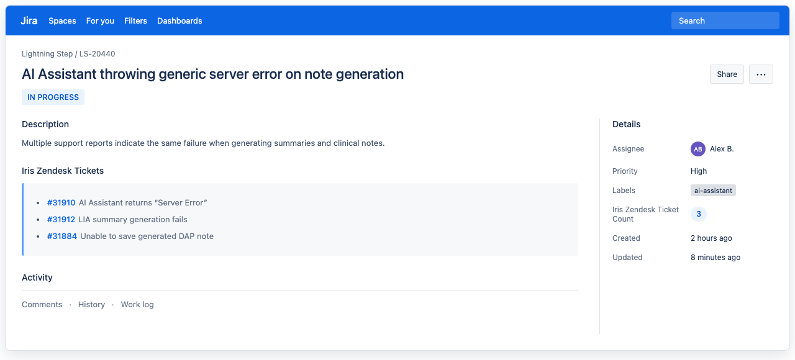

Admins can find these settings after Jira is connected: **Settings** > **Agent Assist App** > **Jira Integration**. The card has three options: **Issue template**, **Field sync**, and **Linked tickets**.

## Issue template

The template prefills the description when an agent creates a Jira issue from the Agent Assist sidebar. Agents can edit it before creating the issue.

1. Open **Issue template**.
2. Enter the default description. Add placeholders where ticket context should go:

   | Placeholder | Replaced with |
   | --- | --- |
   | `{{ticket_id}}` | Support ticket ID |
   | `{{ticket_subject}}` | Support ticket subject |

3. Check the preview and click **Save**.

The template can't be blank and can be up to 10,000 characters. Click **Use product default** to restore the IrisAgent template. Changes apply only to new Jira issues.

## Linked tickets (Zendesk only)

IrisAgent can keep a list of linked Zendesk tickets on each Jira issue.

1. Ask a Jira admin to create these two custom fields with these exact names and types, and add them to the field context and issue layouts of your connected projects:

   | Jira custom field | Type | Value |
   | --- | --- | --- |
   | `Iris Zendesk Tickets` | Paragraph (rich text) | Up to 200 linked tickets (ID, subject, link), then a count of the rest |
   | `Iris Zendesk Ticket Count` | Number | Total linked Zendesk tickets |

2. In IrisAgent, open **Linked tickets**, turn on **Write linked tickets to Jira**, and click **Save**.

How it works:

- Off by default. When on, IrisAgent rewrites both fields when an agent creates or links a Jira issue from the IrisAgent sidebar. Repeat links don't create duplicates.
- Links made elsewhere show up the next time an agent creates or links from the sidebar. IrisAgent does not poll Jira.
- Turning it off stops updates but does not clear existing values.
- The connected Jira user must be able to browse and edit the issues, and both fields must be editable for the issue type.
- If a field is missing, misnamed, the wrong type, or outside the issue's field context, linking still works but the summary is not written.
- Suggested tickets are not included until an agent links them.

Use the count in JQL, for example: `"Iris Zendesk Ticket Count" > 0`

## Field sync (Zendesk only)

Field sync copies Jira values into Zendesk ticket fields, one way, for Jira issues linked through the IrisAgent sidebar or the Zendesk Jira integration.

| Jira source | Compatible Zendesk destinations |
| --- | --- |
| Status | Status, dropdown, text |
| Priority | Priority, dropdown, text |
| Issue type | Dropdown, text |
| Labels | Multi-select, text |
| Issue key | Text |
| Summary | Text, textarea |

Destinations must be active Zendesk custom fields or the standard **Status** and **Priority** fields. Each destination can be used in only one mapping.

1. Open **Field sync** and turn on **Enable field sync**.
2. Click **Add mapping** and pick a Jira source and a Zendesk destination.
3. For dropdowns and standard Status or Priority, add at least one **Value mapping**. Unmapped Jira values are skipped.
4. For custom fields, optionally check **Clear the Zendesk field when the Jira value is empty**. Standard Status and Priority can't be cleared.
5. Click **Save**.

<Warning>
  Updating Zendesk **Status** can run triggers and automations, affect SLAs, send satisfaction surveys, or start auto-close. A Solved update can fail on an unassigned ticket. Closed is not available because it can't be undone.
</Warning>

After you save:

- Only Jira changes ingested after saving are synced. Existing tickets update the next time their Jira issue changes.
- Updates run in the background. If a ticket has several linked Jira issues, the most recently updated one wins.
- With custom ticket statuses, IrisAgent uses the default custom status for the mapped category.
- Renaming a Zendesk field is fine (IrisAgent stores the field ID). If you delete or deactivate one, pick a new destination.

## Related guides

- [Connect Jira Software](/data-sources/Jira-Software)
- [Set up Zendesk](/data-sources/Zendesk)
- [Use the Agent Assist sidebar](/agent-copilot)
