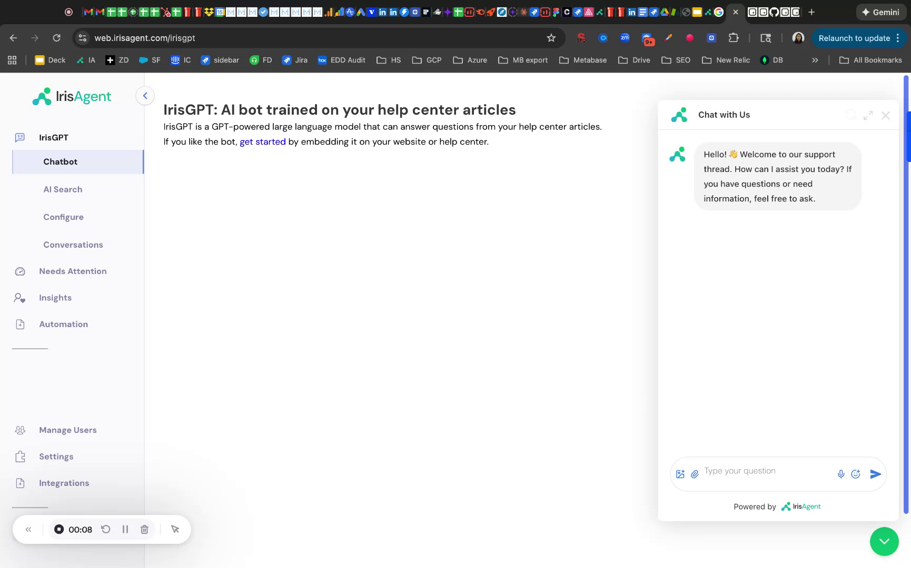
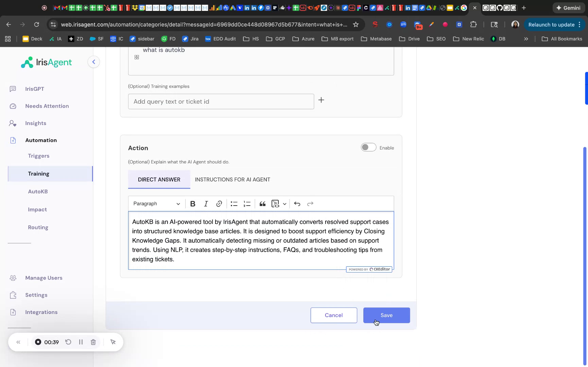

When a chatbot answer could be better, revise it from the dashboard. No code is needed. Each revision is saved as a procedure and applies right away to similar future questions.

## Revise an answer

1. **Find the answer.** Ask the chatbot a test question (for example, "What is AutoKB?"), or pick a real customer conversation.

   

2. **Open the conversation.** In the dashboard, go to **Activity → Conversations** and click the conversation.

   

3. **Click Revise** on the AI answer. This opens a new procedure with the question filled in.
4. **Write the new answer.** Choose a tab:
   - **Instructions for AI Agent:** guidelines on how to answer (tone, length, structure, or context to use). Best when answers can vary.
   - **Direct Answer:** the exact text the chatbot should return. Best for facts and wording that must not change.
5. **Optional: add training examples.** Enter other phrasings of the question or ticket IDs so the AI matches variations.
6. Click **Save**.
7. **Test it.** Ask the chatbot the same question again and confirm it uses your revision.

Answers you have already revised show **Revised** instead of **Revise**. Clicking it opens the existing procedure.

To keep a fixed answer from regressing, click **Turn into eval** on the same reply. It saves the conversation as an [eval](/configuring-ai-and-automation/Evals) you can rerun after every change, and you can run your evals on a procedure before you save it.

## Manage revisions

Go to **Automate → Procedures** to view, edit, or delete any revision. Deleting a revision restores the AI's default behavior.

## Tips

- Keep answers short and direct.
- Link to help center articles where useful.
- Match your brand voice.
- Add training examples for common rephrasings.

## FAQ

<AccordionGroup>
  <Accordion title="How quickly do revisions take effect?">
    Immediately after you click Save.
  </Accordion>
  <Accordion title="Do revisions apply to all channels?">
    Yes, they apply to IrisGPT on every deployed channel (website chatbot, help center, and so on).
  </Accordion>
</AccordionGroup>

## Related

- [Evals](/configuring-ai-and-automation/Evals)
- [Chatbot on Website](/deploying-irisagent/Chatbot-on-Website)
- [Workflows](/configuring-ai-and-automation/Workflows)
- [AI for Macros](/configuring-ai-and-automation/AI-for-Macros)
- [Auto-respond to tickets](/deploying-irisagent/Tickets#auto-respond-with-ai-answers)
