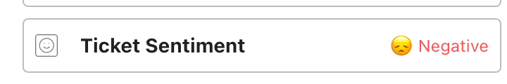
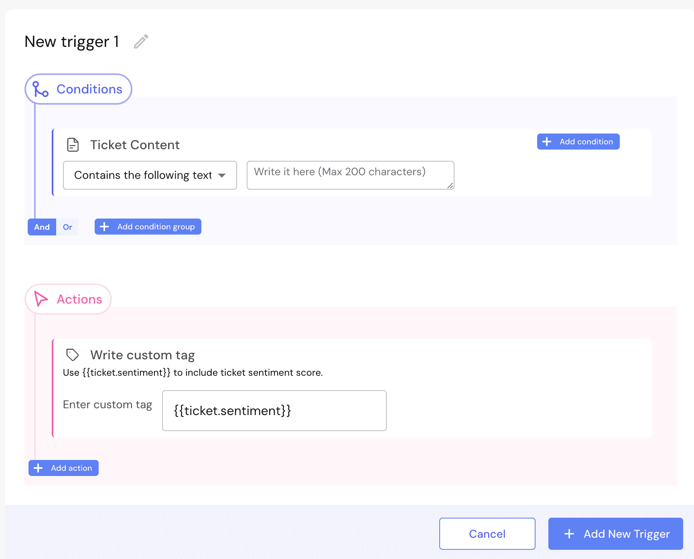

IrisAgent uses AI to detect the emotional tone of each ticket, so your team can spot unhappy customers and respond quickly.

## In the Agent Assist sidebar

Every ticket shows a sentiment in the [Agent Assist sidebar](/agent-copilot) (Zendesk, Salesforce, and others): Positive, Moderate Positive, Neutral, Moderate Negative, or Negative. To hide the sentiment widget from certain agents, contact us.

## On the dashboard

Go to **Overview** in the IrisAgent dashboard. The **Cases that need attention** table shows the sentiment and priority score for your most problematic tickets. Sort by sentiment to see who needs help first.

## Write sentiment to your ticketing system

Add sentiment as a tag so agents see it without opening IrisAgent.

1. Go to **Automate** → **Case Triggers** and click **Create New Trigger**.
2. Add a condition. To cover all tickets, add **Ticket Content** with an empty value.
3. Under **Actions**, select **Write custom tag**.
4. Enter `{{ticket.sentiment}}` in the text box.
5. Click **Add New Trigger**.

IrisAgent then writes the sentiment score (a number from -100 to 100) to the ticket's **Tags** field.

Need help? [Email us](mailto:contact@irisagent.com).
