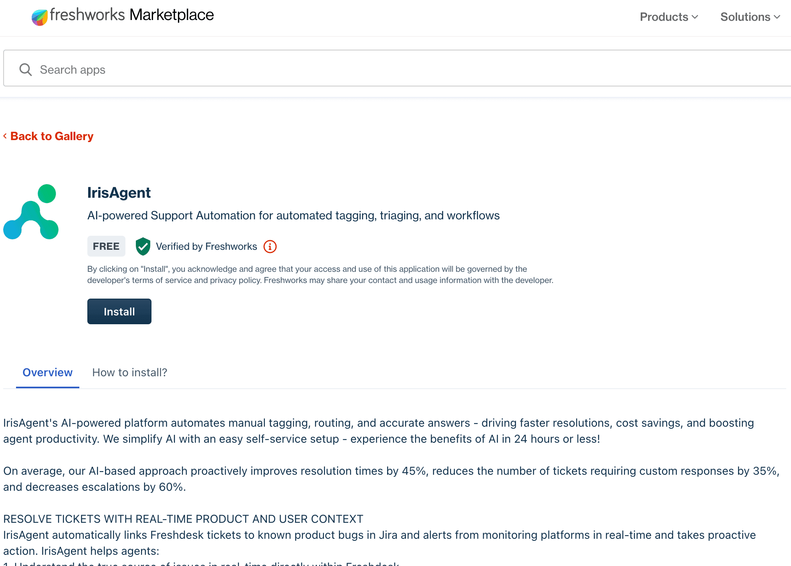

## Connect Freshdesk to IrisAgent

1. Sign in to the [IrisAgent dashboard](https://web.irisagent.com/) with Google, Microsoft, or Okta SSO.
   
2. Choose Freshdesk:
   - **During onboarding:** on **Connect your first data source**, choose **Ticketing system**, then **Freshdesk**.
   - **Later:** go to **Data Sources** → **Ticketing System** and pick **Freshdesk**.
3. Approve the OAuth permissions and click **Allow**. This connects both Freshdesk tickets and Freshdesk Solutions (knowledge).

To add other sources later (Jira, Confluence, Salesforce, and more), go to **Data Sources**.

## Install the IrisAgent app into your Freshworks account

1. Open [IrisAgent on the Freshworks Marketplace](https://www.freshworks.com/apps/freshdesk/irisagent/).
2. Click **Install** and follow the steps.

  
