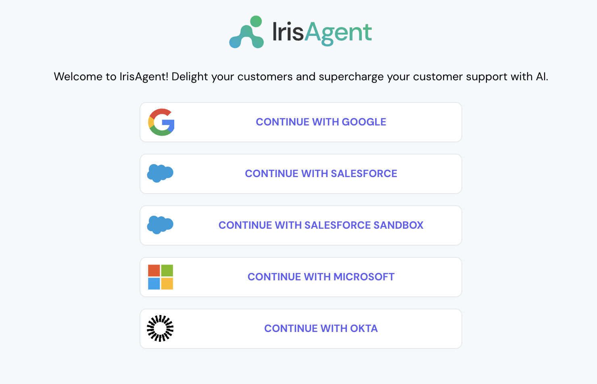
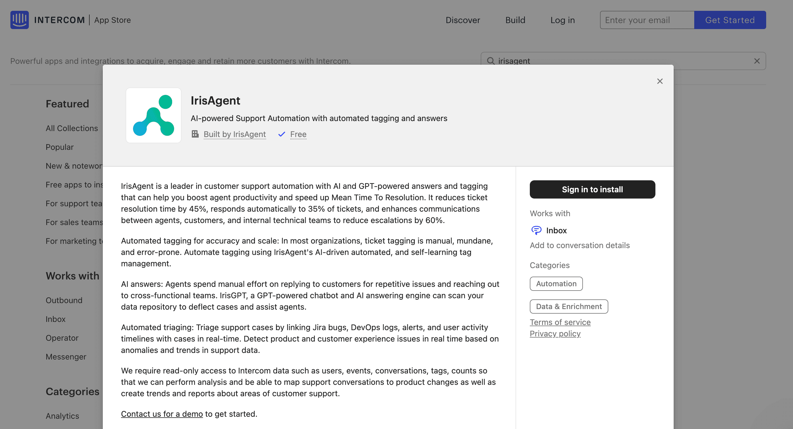

## Connect Intercom to IrisAgent

1. Sign in to the [IrisAgent dashboard](https://web.irisagent.com/) with Google, Microsoft, or Okta SSO.

   

2. Open [Platforms](https://web.irisagent.com/platforms) and click **Connect with Intercom**. Intercom uses its own OAuth flow.
3. Grant the OAuth permissions and click **Allow**. This connects both Intercom tickets and articles.

To add more sources later (Jira, Confluence, Salesforce), open **Data Sources** in the left navigation.

## Install the IrisAgent app into your Intercom account

1. In Intercom, open **Settings → Integrations → App Store**, search for **IrisAgent**, and open the listing. It is also in Intercom's [third-party apps directory](https://www.intercom.com/help/en/articles/11070907-apps-built-by-third-parties-third-party-apps).
2. Click **Install** and follow the prompts.

   
