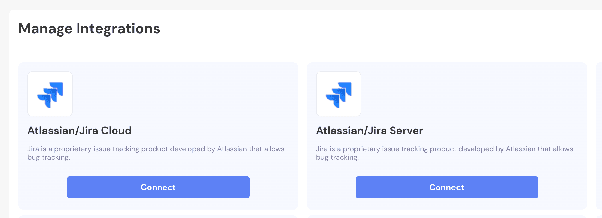

IrisAgent links Jira issues to support cases so your teams can spot related bugs and their customer impact. You can connect Jira Software as an issue provider alongside any primary ticketing system (Zendesk, Salesforce, Intercom, Freshworks, HubSpot, and others).

You can connect several Jira accounts or sites. Each has its own credentials, projects, product routing, comment settings, and ingestion state.

<Note>
  If Jira Service Management is your primary ticketing system, start with the [Jira Service Desk/Jira Software setup guide](/data-sources/Jira-Software-or-Service-Desk).
</Note>

## Before you begin

For each Jira account, create an Atlassian service user that can access only the projects IrisAgent should ingest. The API token has the same permissions as that user. The user needs:

- Read access to the projects and issues to ingest
- Read access to comments, if you enable **Ingest comments**
- Write access to comments, if you enable **Post comments to cases**
- Access to the `/issue/createmeta` endpoint, if agents will create Jira issues from the IrisAgent Copilot app

Create an API token with [Atlassian's instructions](https://support.atlassian.com/atlassian-account/docs/manage-api-tokens-for-your-atlassian-account/).

## Connect your first Jira account

1. Sign in to the [IrisAgent dashboard](https://web.irisagent.com/).
2. Open **Data Sources → Development**.
3. Choose **Atlassian/Jira Cloud**, or **Atlassian/Jira Server** for on-premises Jira.
4. Enter the Jira email, site subdomain, and API token. For Jira Cloud, the subdomain is the part before `.atlassian.net` (for `https://acme.atlassian.net`, enter `acme`).
5. If you use a scoped API token, also enter the Cloud ID from `https://<your-domain>.atlassian.net/_edge/tenant_info`.
6. Select **Connect Jira**.

Ingestion starts only after you select projects (see [Configure and enable a Jira provider](#configure-and-enable-a-jira-provider)).

Admins can also [customize the issue description created from Agent Assist and sync Jira fields to linked Zendesk tickets](/configuring-ai-and-automation/Jira-Integration-Settings).

## Connect a second Jira account

1. On **Data Sources → Development**, click **Configure Jira providers** on the Atlassian/Jira card.
2. Select **Add Jira instance** and fill in:
   - **Provider ID**: a unique internal key, such as `support` or `payments`. 1 to 64 letters, numbers, underscores, or hyphens. It cannot be changed later.
   - **Display name**: the name shown in the dashboard.
   - **Jira email**: the service user's Atlassian email.
   - **Jira subdomain**: the part before `.atlassian.net` for Jira Cloud.
   - **Cloud ID (optional)**: required for scoped API tokens.
   - **API token**: the service user's token.
   - **Use as default provider**: handles cases whose product ID matches no other enabled provider.
3. Select **Connect Jira**.

Repeat for more accounts. Each needs a different Provider ID.

## Configure and enable a Jira provider

New providers start **Disabled**, so nothing is ingested until you choose projects.

1. Open **Configure Jira providers**.
2. In the provider card, select at least one project under **Jira projects**.
3. Under **Project product mapping**, set a product ID for every selected project. Use the exact values in your cases' `productId` field. These values decide which cases route to this provider, and they are stored on ingested issues so Jira search can match issues to cases with the same product.
4. Optionally turn on **Ingest comments** or **Post comments to cases**.
5. Turn on the **Enabled** toggle.
6. Select **Save settings**.

<Warning>
  IrisAgent will not enable a provider with no selected projects, because an empty selection would ingest every project.
</Warning>

### Routing rules

- A case whose `productId` matches a provider's mapped product IDs goes to that provider.
- Otherwise, the enabled **Default provider** handles it. At least one enabled provider must stay the default.
- Product IDs and project keys cannot repeat across enabled providers.

### Example: two Jira accounts

| Setting | Support Jira | Payments Jira |
| --- | --- | --- |
| Provider ID | `support` | `payments` |
| Selected projects | `SUP`, `CSM` | `PAY` |
| Project product mapping | `SUP` → `Support`; `CSM` → `Customer Care` | `PAY` → `Payments` |
| Default provider | Yes | No |

A case with product ID `Payments` uses Payments Jira. Any other product ID uses Support Jira, the default.

## Ingestion

After you enable and save a provider, the next scheduled run imports issues from its projects. This runs in the background, so issues may not appear right away.

- Each account keeps its own credentials, projects, ingestion cursor, and identity, so issues stay distinct even if two accounts share an issue key.
- IrisAgent ingests recent Jira data by default. The lookback window and frequency can be configured for your deployment.
- API requests respect Atlassian rate limits.

## Troubleshooting

**"Select at least one Jira project before enabling this provider."** Choose at least one project under **Jira projects**, then enable and save.

**"Set a product ID for Jira project ... before enabling this provider."** Fill in the **Project product mapping** for every selected project.

**Jira projects are missing.** Make sure the service user can browse those projects. Reconnect the provider if its permissions or token changed.

**A scoped token requires a Cloud ID.** Copy the Cloud ID from `https://<your-domain>.atlassian.net/_edge/tenant_info` and reconnect.

**Product-aware search returns no Jira issues.** Check that each selected project's **Project product mapping** matches the case product ID. New mappings apply as issues are ingested or updated.

## Data governance and security

- Data is encrypted in transit and at rest.
- Jira access is limited to the service user's permissions and the projects you select.
- IrisAgent makes authenticated API requests and respects Atlassian rate limits.
- IrisAgent does not share customer Jira data with third parties.
- IrisAgent is SOC 2 Type II and GDPR compliant.
