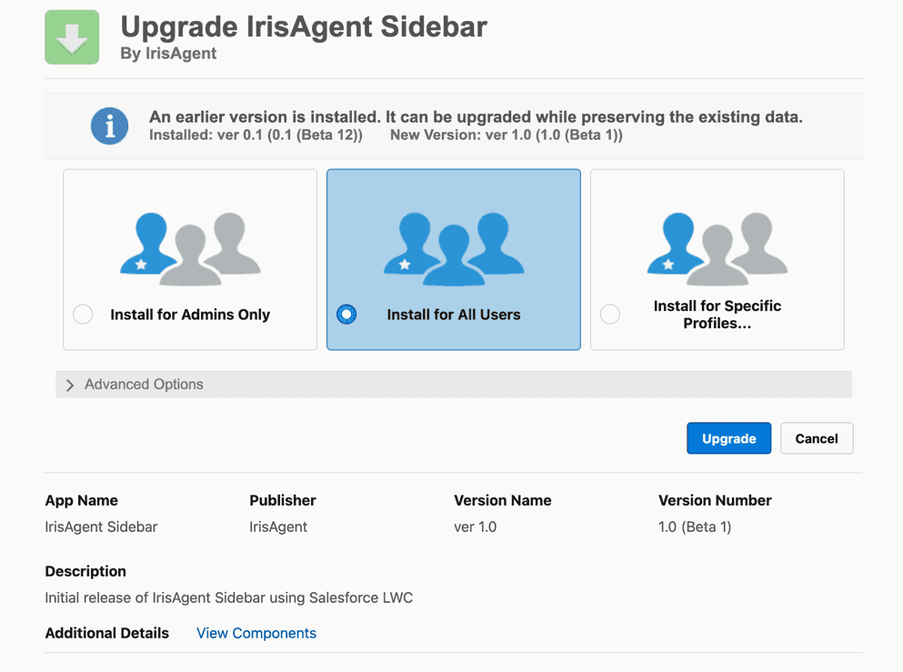

## Connect Salesforce to IrisAgent

A Salesforce admin should do these steps.

1. Sign in to the [IrisAgent dashboard](https://web.irisagent.com/) with Google, Microsoft, or Okta SSO.
2. Choose Salesforce:
   - **During onboarding:** on **Connect your first data source**, choose **Ticketing system**, then **Salesforce**.
   - **Later:** go to **Data Sources → Ticketing System** and pick **Salesforce**.
3. Click **Connect production org** or **Connect sandbox org**.
4. Sign in to Salesforce, grant the OAuth permissions, and click **Allow**.

## Install the IrisAgent app in Salesforce account

1. While logged in to the target org, open the installation link:
   - **Production or Developer org:** [Production installation link](https://login.salesforce.com/packaging/installPackage.apexp?p0=04tak000000pGfRAAU)
   - **Sandbox org:** [Sandbox installation link](https://test.salesforce.com/packaging/installPackage.apexp?p0=04tak000000pGfRAAU) (sandboxes must use `test.salesforce.com`)
2. Select **Install for All Users** (you can restrict profiles later), check the acknowledgment, click **Install**, then **Done**.

## Add IrisAgent to the Lightning case page

1. Go to **Setup → Object Manager** and open the **Case** object.
2. Open **Lightning Record Pages**, then edit or create a page.
3. Add **IrisAgent Sidebar: Inline Email** where you want it. Do not also add the standard **IrisAgent Sidebar** component.
4. Make sure the standard **Email** action is visible in the Case Feed publisher on load. Agents use it to insert Suggested and Dynamic Resolutions into the email composer.
5. Click **Save**, then **Activate** if prompted.

## Share your custom fields

[Email us](mailto:contact@irisagent.com) the API field names for:

1. Article body in Salesforce Knowledge
2. Case priority
3. Any other entity where you use a custom field instead of the standard one

## Permissions accessed by IrisAgent

### OAuth scopes

IrisAgent requests two scopes:

- [`api`](https://help.salesforce.com/s/articleView?id=sf.remoteaccess_oauth_tokens_scopes.htm&type=5): access to the Salesforce REST API.
- `refresh_token`: keeps ingestion running without a new sign-in.

Scopes do not limit which objects or fields IrisAgent can reach. The token inherits the permissions of the user who connects. To keep access minimal, connect with a dedicated integration user (for example "IrisAgent AI"), ideally on the Salesforce Integration (API only) license, and grant only the permissions below through a permission set.

### Object permissions

| Object | Permission | Used for |
|---|---|---|
| Case | Read | Ingesting cases, including custom Case fields you share |
| Case | Create | Creating a case when the chatbot hands off to a ticket |
| Case | Edit | Only if enabled: updating Owner (assignment), Status, or the custom Case fields you choose for tag and classification write-back |
| FeedItem | Read | Reading case comments (Chatter text posts) |
| FeedItem | Create | Only if private notes are enabled: posting internal notes |
| EmailMessage | Read | Reading the case email thread |
| EmailMessage | Create | Only if replies from IrisAgent are enabled: logging the reply |
| Knowledge__kav | Read | Ingesting published Knowledge articles |
| Account | Read | Syncing account details (name, annual revenue, and fields you share) |
| User | Read | Syncing agents for assignment and reporting |
| Group | Read | Syncing queues and public groups for assignment |

Grant field-level read access on custom fields you share, and edit access on Case fields IrisAgent should update.

- IrisAgent never deletes Salesforce records and does not use the Metadata, Tooling, or Apex REST APIs.
- Case updates are sent with assignment rules turned off, so they do not trigger your assignment rules.
- Live chat handoff to Salesforce Messaging for In-App and Web (Enhanced Chat) uses your Messaging deployment's guest access, so it needs no extra object permissions.

### Switching to a new integration user

Contact your IrisAgent point of contact or [email us](mailto:contact@irisagent.com). We enable a token refresh, and you sign in again as the new user. See [Change Integration User](/account-management/Change-Integration-User).

## Finish setup

[Email us](mailto:contact@irisagent.com) when these steps are done. Our team then sets up the machine learning models for your account.
