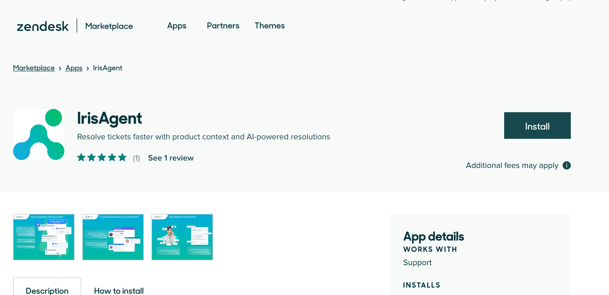

Watch a quick overview of setting up IrisAgent on Zendesk:

<iframe
  width="560"
  height="315"
  src="https://player.vimeo.com/video/1112197683"
  title="IrisAgent integration for Zendesk"
  frameBorder="0"
  allow="accelerometer; autoplay; clipboard-write; encrypted-media; gyroscope; picture-in-picture"
  allowFullScreen
  style={{ width: '100%', borderRadius: '0.5rem' }}
></iframe>

## Connect Zendesk to IrisAgent

1. Sign in to the [IrisAgent Dashboard](https://web.irisagent.com/).
   
2. Choose Zendesk as your ticket source:
   - **During onboarding**: on **Connect your first data source**, choose **Ticketing system**, then **Zendesk**.
   - **Later**: go to **Data Sources** > **Ticketing System** and pick **Zendesk**.
3. Approve the OAuth permissions and click **Allow**. This connects both Zendesk tickets and Zendesk Guide.

To add other platforms (Jira, Confluence, Salesforce), open the matching section under **Data Sources**.

## Install IrisAgent app into your Zendesk account

1. Open [IrisAgent on the Zendesk Marketplace](https://www.zendesk.com/marketplace/apps/support/244660/irisagent/).
2. Click **Install** and follow the steps.

## Knowledge from every Zendesk brand

IrisAgent imports Help Center articles from every active brand that has a Help Center. You do not need a second Zendesk connection.

- If a brand's articles are missing, check that the brand is active and has a Help Center.
- An article is removed only after every brand returns 404 for it.
- If IrisAgent cannot list brands (Zendesk returns 403 or 404), it imports from the subdomain on the token. Other errors fail the import rather than guess.

## What's next

- [Macro suggestions](/configuring-ai-and-automation/AI-for-Macros) turn on automatically after you connect.
- Procedures can use **Create Zendesk ticket** (under **Actions** > **Connected actions**) with no extra setup. Insert `{{Create Zendesk ticket}}` where the ticket should be created. See [Create Zendesk tickets from a procedure](/configuring-ai-and-automation/Workflows#create-zendesk-tickets-from-a-procedure).
- If Jira is connected, admins can [customize Jira issues and sync Jira fields into Zendesk](/configuring-ai-and-automation/Jira-Integration-Settings).
