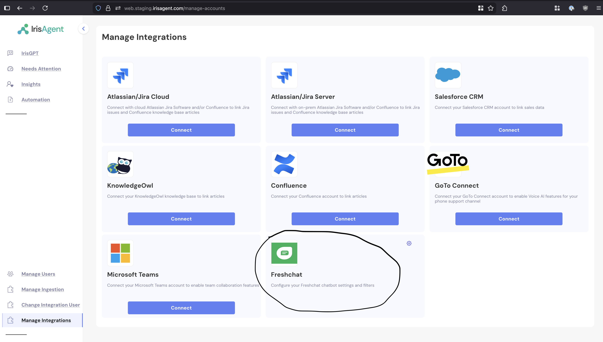
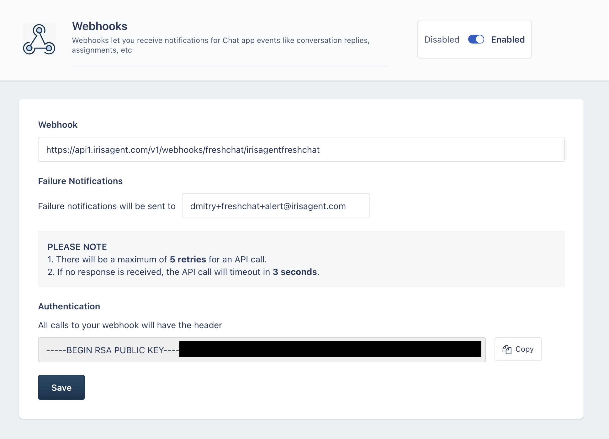
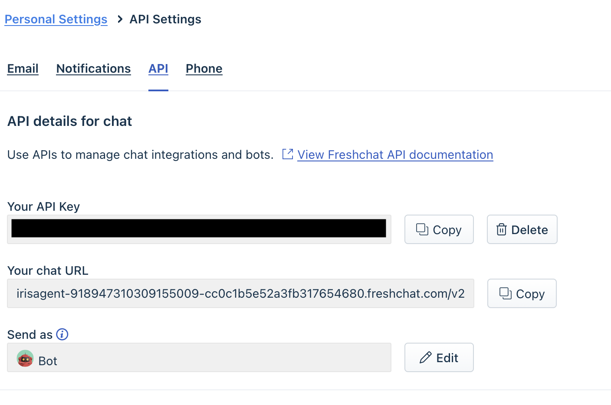
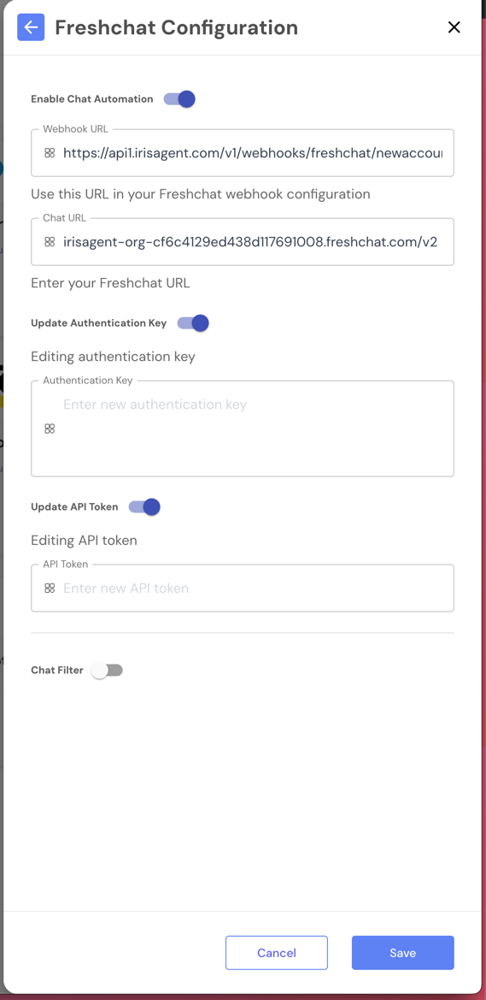
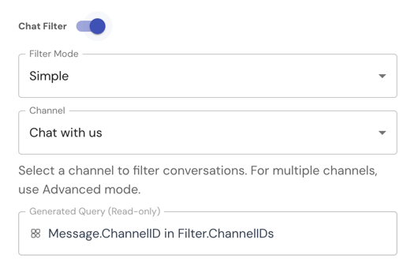

IrisAgent answers customers in Freshchat through a webhook. Keep the IrisAgent and Freshchat settings open side by side: you copy values in both directions.

## Step 1: Turn on Freshchat in IrisAgent

1. In the IrisAgent dashboard, go to **Deploy** → **Chat channels**.
2. On the **Freshchat** card, click **Configure**.
3. Turn on **Enable AI Chat Assistant**.
4. Copy **Your Webhook URL**. It looks like `https://api1.irisagent.com/v1/webhooks/freshchat/{YourOrganizationID}`.

  

## Step 2: Add the webhook in Freshchat

1. Sign in to Freshchat and open the admin settings (`https://{YourOrganizationID}.myfreshworks.com/crm/sales/settings`).
2. In **Conversation Webhooks**, add or configure a webhook and paste the IrisAgent webhook URL.
3. Copy the webhook's **Authentication Key** (RSA public key).
4. Save and enable the webhook.

  

## Step 3: Copy your Freshchat API details

In Freshchat **API Settings**, copy **Your API Key** and **Your chat URL**.

  

## Step 4: Finish the IrisAgent configuration

Back in the IrisAgent **Freshchat Configuration** panel, enter:

| IrisAgent field | Value from Freshchat |
| --- | --- |
| **Freshchat Domain** | Your chat URL, e.g. `yourcompany.freshchat.com/v2` |
| **Authentication Key** | The webhook authentication key from Step 2 |
| **API Token** | Your API key |

Then click **Save**.

  

## Optional settings

- **Hand-off Trigger:** stop the AI when the conversation is assigned to an agent, or when an agent sends a message.
- **Chatbot User ID:** the Freshchat user that represents the bot. IrisAgent keeps responding when this user sends a message.
- **Escalation Routing:** send conversations to an **Agent ID** or **Group ID** when a customer asks for a human.
- **Conversation Filtering:** limit which conversations IrisAgent answers. Choose **Channel-based (Simple)** and pick a channel, or **Custom Query (Advanced)** and enter a filter expression. With filtering off, IrisAgent handles all conversations.

  
