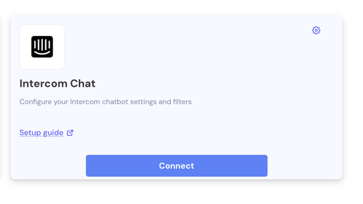

IrisAgent answers customer questions in your Intercom Messenger. You connect Intercom in a few clicks; no private app or webhook setup is needed.

**You need:** IrisAgent admin access, Intercom connected as your ticketing system in IrisAgent, and an Intercom admin account.

## 1. Connect Intercom

1. In IrisAgent, go to **Deploy → Chat channels** and click the **Intercom Chat** card.
2. Click **Connect Intercom Chatbot**, then sign in to Intercom and authorize IrisAgent.

The card shows **Connected** when it's done.

## 2. Choose the teammate IrisAgent replies as

IrisAgent posts its answers as an Intercom teammate. Pick one (for example, a teammate named "IrisAgent") and copy their [user ID](https://developers.intercom.com/docs/references/rest-api/api.intercom.io/Models/contact_reply_intercom_user_id_request/):

1. In Intercom, go to **Settings → Teammates** and click the teammate's name.
2. Copy the ID at the end of the URL: `https://app.intercom.com/a/apps/intercom_id/admins/user_id`.

## 3. Turn on chat automation

1. On the **Intercom Chat** card, click the settings (gear) icon to open **Intercom Chat Configuration**.
2. Turn on **Enable Chat Automation**.
3. Enter the **Chatbot User ID** from step 2.
4. Optional:
   - **Hand-off Trigger:** stop answering when the conversation is assigned to an agent, or when an agent sends a message.
   - **Escalation Routing:** when a customer asks for a person, assign the conversation to a teammate, team or tag (Teammate ID, Team ID, Tag ID).
   - **Filters:** answer only the conversations that match your filter.
5. Click **Save**.

## Test it

Open your Intercom Messenger, ask a common question, and check that IrisAgent answers from your knowledge base.

<Note>
The **Intercom Chat** card appears only when Intercom is connected as your ticketing system. See [Intercom](/data-sources/Intercom).
</Note>
