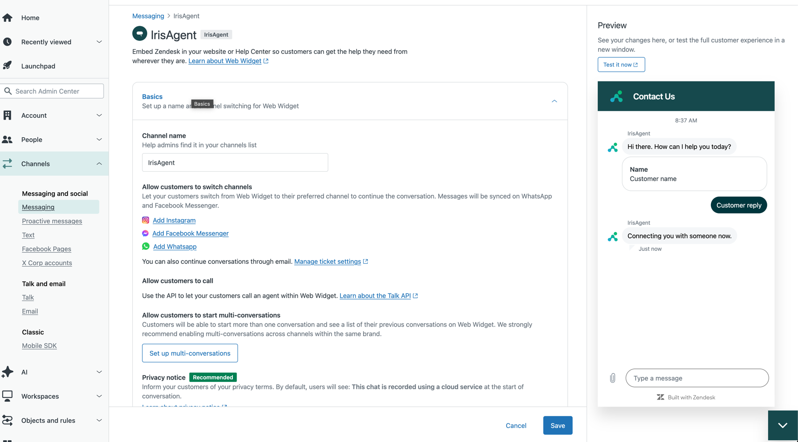
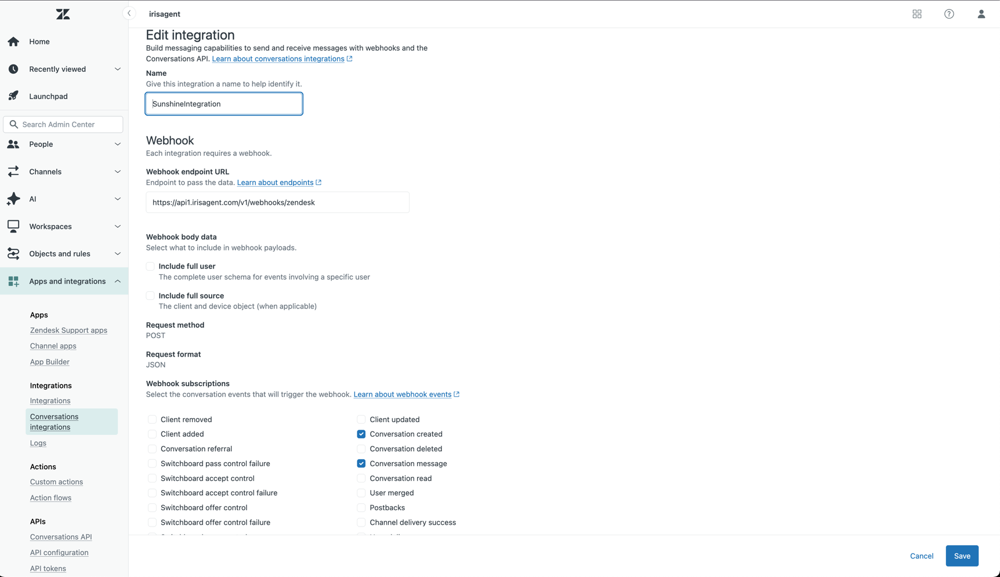
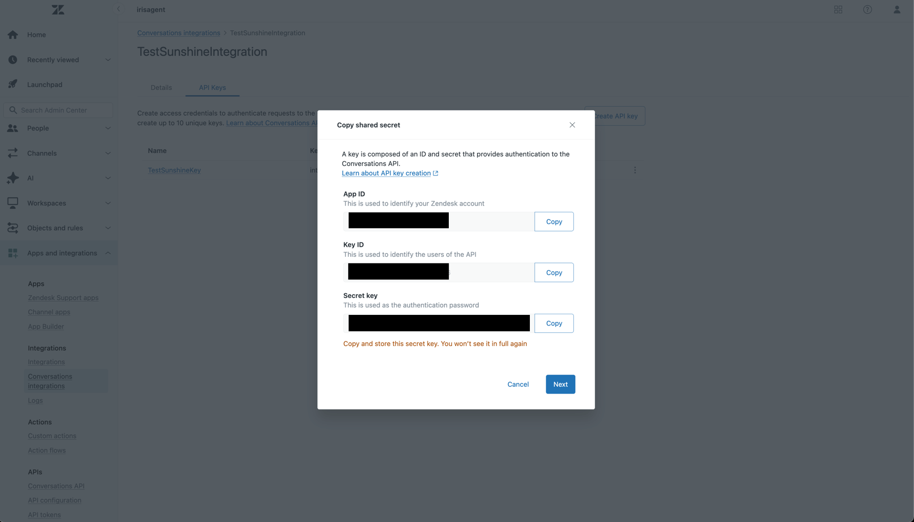

Connect IrisAgent to Zendesk Messaging (Sunshine Conversations) so it answers your messaging conversations.

## Prerequisites

- **Messaging for Web** set up in Zendesk with a working Web Widget. See Zendesk's guide: [Getting started with messaging](https://support.zendesk.com/hc/en-us/articles/4408827701530-Getting-started-with-messaging-for-your-website-help-center-and-mobile-apps).
- Zendesk Suite Professional plan or above.



## Step 1: Create a Conversations Integration

Zendesk guide: [Creating conversations integrations in Admin Center](https://support.zendesk.com/hc/en-us/articles/4576083789850-Creating-conversations-integrations-in-Admin-Center).

1. In Zendesk Admin Center, go to **Apps and integrations** > **Integrations** > **Conversations integrations**.
2. Click **Create integration** and name it (for example, "IrisAgent Integration").
3. Set the webhook:
   - **Target URL**: `https://api1.irisagent.com/v1/webhooks/zendesk`
   - **Events**: `conversation:create`, `conversation:message`, and `switchboard:releaseControl`
4. Click **Save**.
5. Copy the **Webhook ID** and **Shared secret** from the integration details page.



<Warning>
  The shared secret is shown only once. Copy it before you leave the page.
</Warning>

If you already have an IrisAgent integration, edit its webhook in Zendesk and add `switchboard:releaseControl`. Saving in IrisAgent does not change Zendesk event subscriptions.

## Step 2: Generate API Keys

1. In your Conversations integration, open the **API Keys** tab.
2. Click **Create API key** and name it.
3. Click the key and copy the **App ID**, **Key ID**, and **Secret key**. The secret key is shown only once.



## Step 3: Configure IrisAgent

1. In IrisAgent, go to **Deploy** > **Chat channels**.
2. On the **Zendesk Sunshine** card, click **Configure**.
3. Turn on **Enable Chat Automation**.
4. Under **Webhook Credentials**, enter the **Webhook ID** and **Shared secret**.
5. Under **API Key**, enter the **App ID**, **Key ID**, and **Key Secret** (the Zendesk secret key).
6. Click **Save**.

## Step 4: Limit IrisAgent to Specific Widgets or Brands (Optional)

The integration is account-wide, so by default IrisAgent answers in every Web Widget and brand. To limit it, use the **Chat Filter**. You do not need a second integration or API key.

The filter is an allow-list. When it is on, IrisAgent answers only matching conversations and ignores the rest, including any new widget you launch later.

| Your setup                          | Match on                 | Filter mode |
| ----------------------------------- | ------------------------ | ----------- |
| Widgets are on separate brands      | Brand ID                 | Simple      |
| Widgets share one brand             | Messaging integration ID | Advanced    |

1. In the **Zendesk Sunshine Configuration** panel, turn on **Chat Filter**.
2. Pick a **Filter Mode**:
   - **Simple**: enter the **Brand ID**. The read-only **Generated Query** shows the resulting expression.
   - **Advanced**: enter an expression in **Query** (examples below).
3. Click **Save**.

<Tip>
  The Chat Filter works independently of **Enable Chat Automation**, so you can set it up before turning automation on.
</Tip>

### Advanced expressions

The expression must return true or false. Invalid expressions are rejected when you save.

```
Message.Source.IntegrationID == "YOUR_INTEGRATION_ID"
Message.Source.IntegrationID in ["FIRST_INTEGRATION_ID", "SECOND_INTEGRATION_ID"]
Conversation.BrandID == "YOUR_BRAND_ID" and Message.Source.IntegrationID == "YOUR_INTEGRATION_ID"
```

| Field                                                     | Meaning                                          |
| --------------------------------------------------------- | ------------------------------------------------ |
| `Conversation.BrandID`                                    | Zendesk brand of the conversation                |
| `Conversation.ActiveSwitchboardIntegration.IntegrationID` | Integration currently handling the conversation  |
| `Message.Source.IntegrationID`                            | Web Widget (messaging integration) of the message |
| `Message.Source.Type`                                     | Source type, for example `web`                   |
| `Message.Content.Text`                                    | Message text                                     |

You cannot filter on ticket fields or tags. IrisAgent replies before the ticket exists.

### Finding IDs

- **Brand ID**: Zendesk Admin Center > **Account** > **Brands**, open the brand. The ID is in the URL.
- **Messaging integration ID**: send a test message through each widget, then contact IrisAgent support. We can read the brand and integration ID each widget reports.

## Step 5: Configure Human Handoff and Zendesk Routing

Zendesk webhook conversations use the chatbot configuration marked **Default**. Add these settings there.

1. Go to **AI Products** > **Chatbot** and click **Configure and deploy**.
2. Select the **Default** configuration and open the **Handoff** tab.
3. Set **Method** to **Start a live chat**.
4. In **Zendesk ticket tags**, enter comma-separated tags (optional). Each tag can be up to 80 characters with no spaces. You can add up to 20 tags. Example: `escalated_to_human, priority_support`
5. Click **Update Configuration**.

When a procedure runs **Escalate to human**, IrisAgent:

1. Sends the procedure's handoff response.
2. Adds your tags to the active Zendesk ticket.
3. Passes Switchboard control to Zendesk Agent Workspace and stops replying.

IrisAgent resumes only when Zendesk sends `switchboard:releaseControl` after the human session. A new ticket alone does not reset the handoff.

### Route the tagged ticket in Zendesk

Create a Zendesk trigger on your tag (for example, `escalated_to_human`) that sets the group, priority, or skills. IrisAgent does not pick a Zendesk group.

<Warning>
  Tagging is best-effort. If IrisAgent cannot find or tag the ticket, it still hands control to Agent Workspace, and tag-based triggers will not fire. Add a fallback routing rule for untagged messaging handoffs if you need one.
</Warning>

## Verify

1. Send a test message through your Web Widget.
2. Trigger **Escalate to human**.
3. Check that the ticket has your tags, your trigger routed it, and IrisAgent stopped replying.
4. Close the ticket, send another message as the same user, and confirm IrisAgent replies again.

If something does not work, check that:

- All credentials are correct.
- The webhook subscribes to all three events. If IrisAgent stays silent after a human session, confirm Zendesk delivered the release event.
- Your test widget matches the Chat Filter, if you set one. A filter that matches nothing stops all answers.
- The **Default** chatbot configuration uses **Start a live chat** with valid tags.
- Zendesk is connected as a ticketing source (needed for tagging).
- Your trigger conditions match the exact tag.

## Resources

- [Zendesk Messaging documentation](https://support.zendesk.com/hc/en-us/articles/4408827701530)
- [Conversations integrations guide](https://support.zendesk.com/hc/en-us/articles/4576083789850)
- [Sunshine Conversations API](https://developer.zendesk.com/api-reference/conversations/)
