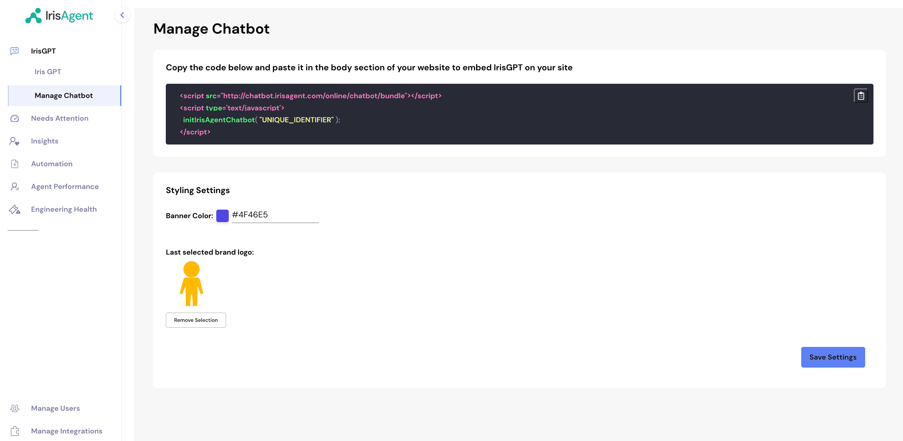

The IrisAgent chatbot answers support questions on any website. You can match it to your brand (colors, logo, welcome message) and see every conversation in IrisAgent.

## Set up and deploy

1. Go to **AI Products → Chatbot** and click **Configure and deploy**. The default configuration opens. Use the configuration selector to switch, or **New configuration** to add one.

    

2. Customize the chatbot. See [Configuration options](#configuration-options).
3. Click **Deploy**, then **Reveal API Key**, and paste the snippet into your website's `<body>`:

   ```html
    <script async
       src="https://chatbot.irisagent.com/web.iife.js"
       data-token="UNIQUE_IDENTIFIER"
       data-host="https://api1.irisagent.com"
      >
   </script>
   ```

4. Conversations appear under **Activity → Conversations**.

## Configuration options

Configure the chatbot in two ways:

- **Configuration editor** (recommended): no code needed.
- **Embed snippet** (advanced): pass a full theme with `data-theme`. See [Advanced theming](#advanced-theming).

### Settings in the configuration editor

The editor has **Instructions**, **Behavior**, **Appearance**, **Handoff**, **Localization**, and **Advanced** tabs.

| Setting | Description | Default |
| --- | --- | --- |
| **Configuration name** | Shown in the chatbot header and used to identify the configuration. | None |
| **Banner color** | Brand color for the launcher button and accents. | `#0cb49e` |
| **Logo** | Shown in the chat header. Upload PNG/SVG/JPG (max 2&nbsp;MB) or enter a URL. | IrisAgent logo |
| **Welcome message** | First message visitors see. | `Hello! 👋 Welcome to our support thread. How can I assist you today?` |
| **Automatically open the chat window on page load** | On: the window expands on page load. Off: visitors see only the launcher until they click it. By default it auto-opens on desktop only. | On |
| **Show a proactive message** | A message card next to the launcher while the chat is collapsed. | On |
| **Handoff method** | What happens when a visitor needs a human: show the procedure message or contact details, open a support ticket, or start a live chat. | Show procedure message / contact details |
| **AI Response Style** | Answer guidelines for tone, phrasing, and formatting. Up to 2,000 characters. | None |
| **Language** | Fixes the conversation language. If unset, the chatbot translates automatically. | Auto |
| **Product** | Restricts the chatbot to articles for one product. | None |

<Warning>
Only set a **Product** if your articles have a matching product ID (under **Settings → Article Product Classifier**). Otherwise chats may return no answer. See [Product Segmentation](/configuring-ai-and-automation/Product-Segmentation).
</Warning>

### Handoff options

- **Open a support ticket** needs a ticketing or CRM data source connected first. If you signed up with a website link only, connect one such as [Salesforce](/data-sources/Salesforce).
- **Start a live chat** with **Live chat destination** set to **IrisAgent inbox**: your team replies from the dashboard. Escalated chats appear in the **Waiting** queue in Conversations. See [Live chat](/helpdesk/Live-Chat).
- **Start a live chat** to Salesforce: visitors stay in the widget while agents reply in Salesforce. First set up an Enhanced Chat custom client deployment. See [Salesforce Live Chat Handoff](/deploying-irisagent/Salesforce-Live-Chat).
- **Start a live chat** for Zendesk Messaging webhook deployments: optionally enter Zendesk ticket tags. On escalation, IrisAgent adds the tags and passes Switchboard control to Zendesk Agent Workspace. See [Chatbot Automation on Zendesk Messaging](/deploying-irisagent/Chatbot-Automation-on-Zendesk-Messaging#step-5-configure-human-handoff-and-zendesk-routing).

### Advanced theming

Pass a **Base64-encoded** theme JSON in the `data-theme` attribute. Encode it with `btoa(JSON.stringify(theme))` in a browser console. Omitted fields use IrisAgent defaults.

```html
<script async
  src="https://chatbot.irisagent.com/web.iife.js"
  data-token="UNIQUE_IDENTIFIER"
  data-host="https://api1.irisagent.com"
  data-theme="BASE64_ENCODED_THEME_JSON"
>
</script>
```

The theme has these optional top-level sections:

```json
{
  "button": { "...": "launcher button & auto-open" },
  "tooltip": { "...": "proactive message bubble" },
  "chatWindow": { "...": "chat window, messages, input, footer" },
  "form": { "...": "lead/contact form colors" },
  "disclaimer": { "...": "consent pop-up" },
  "customCSS": "advanced CSS overrides"
}
```

#### Launcher button (`button`)

| Option | Description | Default |
| --- | --- | --- |
| `backgroundColor` | Button background color. | `#0cb49e` |
| `iconColor` | Button icon color. | `white` |
| `customIconSrc` | URL of a custom launcher icon. | IrisAgent icon |
| `size` | `small`, `medium`, `large`, or a number of pixels. | `48` |
| `bottom` | Distance from the bottom of the screen, in pixels. | `20` |
| `right` | Distance from the right of the screen, in pixels. | `20` |
| `dragAndDrop` | Allow visitors to drag the button. | `true` |
| `autoWindowOpen.autoOpen` | Auto-expand the chat window on page load. | `true` |
| `autoWindowOpen.openDelay` | Delay before auto-opening, in seconds. | `0` |
| `autoWindowOpen.autoOpenOnMobile` | Also auto-open on mobile devices. | `false` |

#### Proactive message (`tooltip`)

| Option | Description | Default |
| --- | --- | --- |
| `showTooltip` | Show the proactive message bubble. | `true` |
| `tooltipMessage` | The bubble text. | `Hi, how can I help?` |
| `tooltipBackgroundColor` | Bubble background color. | `#0cb49e90` |
| `tooltipTextColor` | Bubble text color. | `white` |
| `tooltipFontSize` | Bubble font size, in pixels. | `12` |

#### Chat window (`chatWindow`)

| Option | Description | Default |
| --- | --- | --- |
| `title` | Header title. | `Chat with Us` |
| `titleAvatarSrc` | Header avatar image URL. | IrisAgent logo |
| `titleTextColor` | Header text color. | `#303235` |
| `titleBackgroundColor` | Header background color. | `white` |
| `showTitle` | Show the header bar. | `true` |
| `welcomeMessage` | First bot greeting. | `Hello! 👋 ...` |
| `errorMessage` | Message shown when a request fails. | Default error text |
| `backgroundColor` | Chat window background color. | `#ffffff` |
| `backgroundImage` | Background image URL. | none |
| `height` | Window height, in pixels. | `700` |
| `width` | Window width, in pixels. | `400` |
| `fontSize` | Base font size, in pixels. | `14` |
| `starterPrompts` | Array of suggested prompts shown to visitors. | `[]` |
| `starterPromptFontSize` | Starter prompt font size, in pixels. | `15` |
| `clearChatOnReload` | Reset the conversation on page reload. | `false` |
| `renderHTML` | Render HTML in bot responses. | `true` |
| `showAgentMessages` | Show agent reasoning steps (for agent flows). | `true` |
| `sourceDocsTitle` | Heading shown above cited sources. | `Sources:` |
| `poweredByTextColor` | Color of the "powered by" text. | None |

#### Message input (`chatWindow.textInput`)

| Option | Description | Default |
| --- | --- | --- |
| `placeholder` | Input placeholder text. | `Type your question` |
| `backgroundColor` | Input background color. | `#ffffff` |
| `textColor` | Input text color. | `#303235` |
| `sendButtonColor` | Send button color. | `#3B81F6` |
| `maxChars` | Maximum characters per message. | `500` |
| `maxCharsWarningMessage` | Warning shown when the limit is exceeded. | Default warning text |
| `autoFocus` | Focus the input when the chat opens. | `true` |
| `sendMessageSound` | Play a sound when the visitor sends a message. | `true` |
| `sendSoundLocation` | URL of the send sound. | Default sound |
| `receiveMessageSound` | Play a sound when a reply arrives. | `true` |
| `receiveSoundLocation` | URL of the receive sound. | Default sound |

#### Messages (`chatWindow.userMessage`, `chatWindow.botMessage`)

| Option | Description | Default (bot / user) |
| --- | --- | --- |
| `backgroundColor` | Message bubble background. | `#f5f5f5` / `#0cb49e` |
| `textColor` | Message text color. | `#303235` / `#ffffff` |
| `showAvatar` | Show an avatar next to messages. | `true` / none |
| `avatarSrc` | Avatar image URL. | IrisAgent logo / none |

#### Footer (`chatWindow.footer`)

| Option | Description | Default |
| --- | --- | --- |
| `showFooter` | Show the footer. | `true` |
| `text` | Footer text. | `Powered by` |
| `company` | Company name shown in the footer. | None |
| `companyLink` | Link for the company name. | `https://irisagent.com` |
| `textColor` | Footer text color. | `#303235` |

#### Other sections

| Section / option | Description | Default |
| --- | --- | --- |
| `chatWindow.feedback.color` | Color of the thumbs up/down feedback icons. | `#3B81F6` |
| `chatWindow.dateTimeToggle.date` | Show the date on messages. | `true` |
| `chatWindow.dateTimeToggle.time` | Show the time on messages. | `true` |
| `form.backgroundColor` | Background color of lead/contact forms. | `white` |
| `form.textColor` | Text color of lead/contact forms. | `black` |
| `disclaimer` | Consent pop-up shown before chatting. Supports `title`, `message`, `textColor`, `backgroundColor`, `buttonText`, `buttonColor`, `buttonTextColor`, `denyButtonText`, `denyButtonBgColor`, `blurredBackgroundColor`. | Disabled |
| `customCSS` | Raw CSS string for advanced visual overrides. | IrisAgent defaults |

### Full example

```json theme.json
{
  "button": {
    "backgroundColor": "#0cb49e",
    "iconColor": "white",
    "size": 48,
    "bottom": 20,
    "right": 20,
    "dragAndDrop": true,
    "autoWindowOpen": {
      "autoOpen": true,
      "openDelay": 2,
      "autoOpenOnMobile": false
    }
  },
  "tooltip": {
    "showTooltip": true,
    "tooltipMessage": "Hi, how can I help?",
    "tooltipBackgroundColor": "#0cb49e90",
    "tooltipTextColor": "white",
    "tooltipFontSize": 12
  },
  "chatWindow": {
    "title": "Chat with Us",
    "welcomeMessage": "Hello! 👋 How can I help you today?",
    "starterPrompts": ["How do I reset my password?", "Track my order"],
    "textInput": {
      "placeholder": "Type your question",
      "maxChars": 500
    }
  }
}
```
