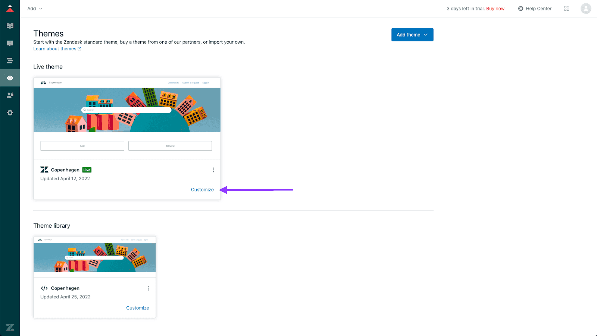

Add IrisAgent AI search and answers to your Zendesk Help Center to deflect tickets.

## Prerequisites

- Admin access to Zendesk Help Center (Suite Growth or above, or Guide Professional or above)
- Access to the IrisAgent dashboard

## Install

1. In Zendesk, click the **Zendesk Products** icon in the top bar and select **Knowledge**.
2. In **Knowledge admin**, click **Customize design** to open Themes.
3. Either click **Customize** on your Live theme, or copy it first (**Add theme**, or the three dots > **Copy** on the Live theme) and edit the copy.
    
4. Click **Edit code**.
5. Under **Templates**, open `footer.hbs`.
6. Paste the snippet from the IrisAgent [Configure page](https://web.irisagent.com/manage-chatbot) just before the closing `</footer>` tag. You also manage chatbot settings on that page.
7. Click **Save**. Optionally click **Preview** to check the layout.
8. If you edited a copy, go back to Themes and click **Set as live theme**.

## If the Zendesk messaging widget hides the chatbot

The Zendesk Messaging Web Widget can cover the chatbot. To turn off its auto-embed:

1. In Zendesk Admin Center, go to **Channels** > **Messaging and Social** > **Messaging**.
2. If you have a **Web Widget** channel, edit it. (If not, you're done.)
3. In **Installation**, clear **Automatically embed Web Widget in your help center**.
4. Click **Save**.
