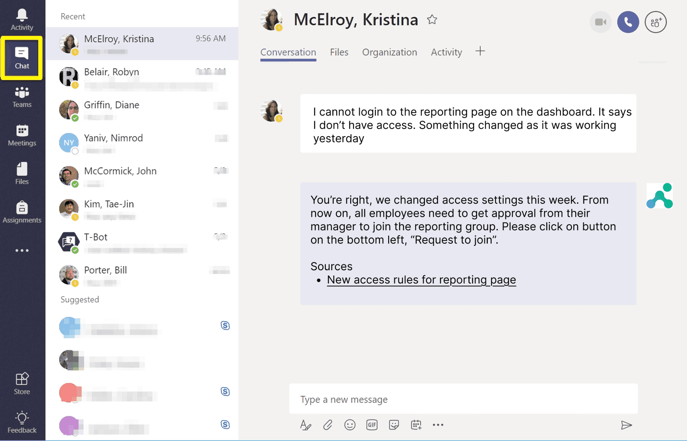
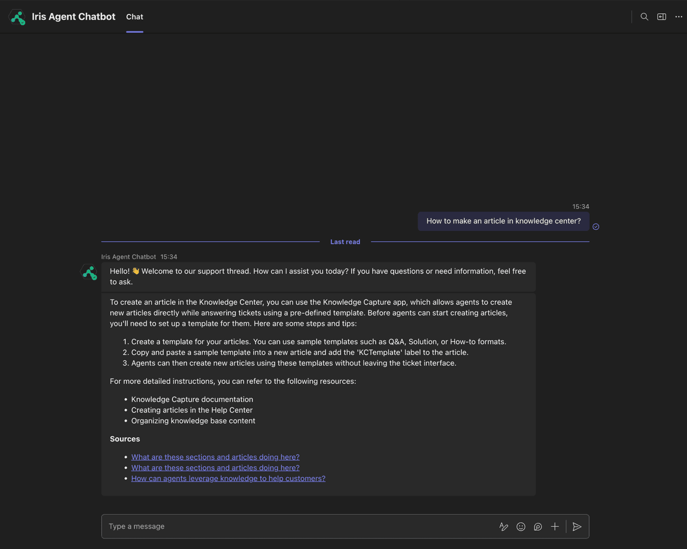

Use the IrisAgent chatbot inside Microsoft Teams to find answers without leaving Teams.

## Prerequisites

- Admin access to the Microsoft Teams Admin Center
- The [`irisagent-chatbot.zip`](https://github.com/IrisAgent/docs/raw/main/assets/msteams/irisagent-chatbot.zip) app package

## Step 1: Upload the app to Teams

1. Open [Teams Admin Center > Manage apps](https://admin.teams.microsoft.com/policies/manage-apps).
2. Click **Upload new app** and select `irisagent-chatbot.zip`.
3. Follow the prompts to finish.

## Step 2: Find your Tenant ID

- In the Azure Portal: **Azure Active Directory** > **Properties** > **Tenant ID**, or
- From the Teams Admin Center URL.

## Step 3: Connect your tenant in IrisAgent

1. In IrisAgent, go to **Deploy** > **Chat channels**.
2. On the **Microsoft Teams** card, click **Connect**.
3. Under **Add New Tenant**, enter your **Tenant ID** and click **Save**.

The tenant then appears under **Connected Tenants**. If you need help, contact the IrisAgent team.

## Use it in Teams

1. In Teams, search apps for **IrisAgent** and open it.
2. Start a conversation.

You can also add the app to a channel and ask questions by mentioning it.

