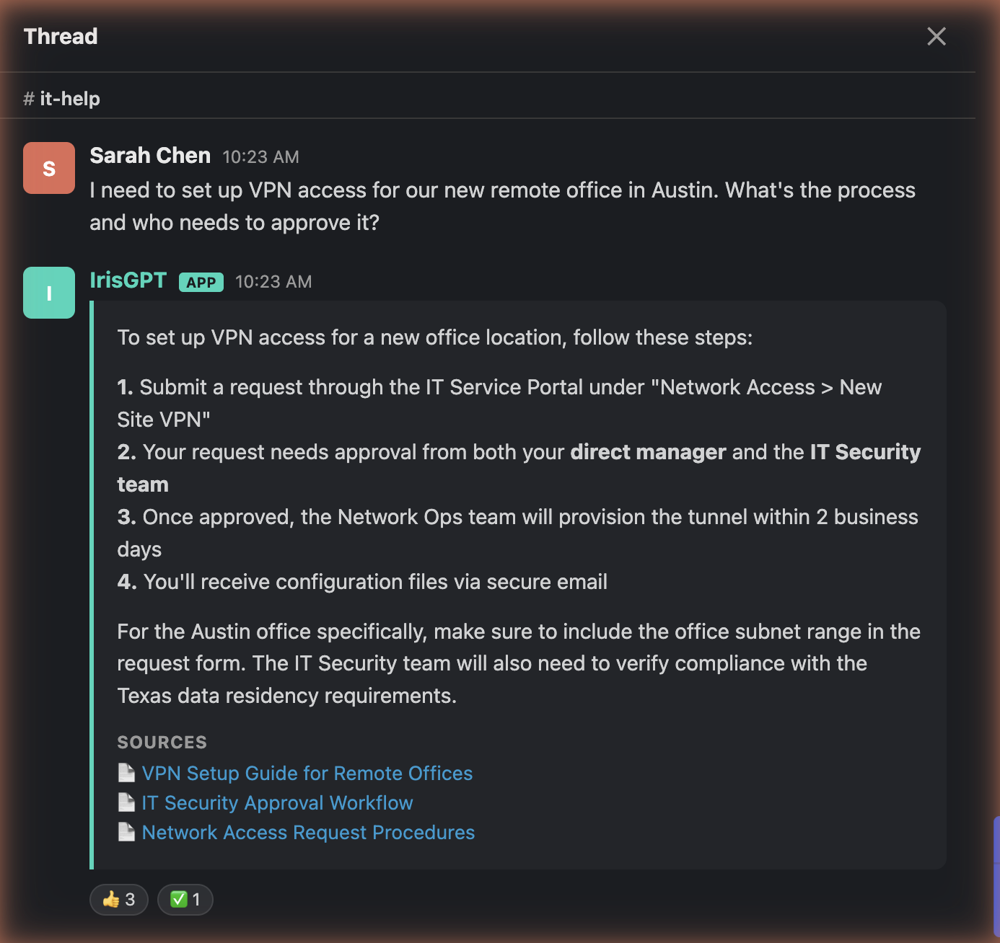
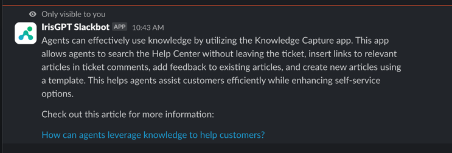
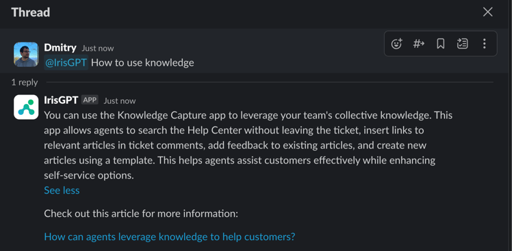

IrisGPT for Slack answers customer and employee questions inside your Slack workspace. [Contact us](https://irisagent.com/get-a-demo/) to get started.



## Set up

### Step 1: Install IrisGPT

In IrisPortal, go to **Deploy → Chat channels**, click **Configure** on the **Slack** card, then click **Add to Slack**. Approve the app when Slack asks. Your IrisAgent contact handles the rest of the app configuration.

<Note>
The bot may appear as **IrisGPT** or **IrisGPT Slackbot**. Both are the same app.
</Note>

### Step 2: Choose a mode

Agree on a mode with your IrisAgent contact:

- **Channel auto-reply:** IrisGPT answers every message in channels it's added to. Best for dedicated help channels.
- **Mention:** IrisGPT answers only when mentioned with `@IrisGPT`. Best for general channels.

### Step 3: Add IrisGPT to channels

The bot must be in a channel to respond there.

1. Open the channel and click its name to open **Channel Details**.
2. Go to **Integrations**, click **Add Apps**, and select **IrisGPT**.

## Use IrisGPT

- **`/askIrisGpt`:** ask privately. Only you see the reply.

  ```
  /askIrisGpt how do I reset my password?
  ```

  

- **`@IrisGPT`:** mention the bot in a channel it's in. It replies in a public thread.

  ```
  @IrisGPT how do I reset my password?
  ```

  

- **App Home:** open the IrisGPT app to see a welcome message with a link to IrisAgent resources.

## Proactive notifications

IrisGPT can post updates to a Slack channel:

- **New & trending issue categories:** newly emerging or spiking issue categories
- **New AutoKB articles:** new auto-generated knowledge base articles
- **Weekly AI performance digest**

To turn them on:

1. Go to **Deploy → Chat channels** and click **Configure** on the **Slack** card.
2. Turn on **Enable Slack notifications**.
3. Choose the **Channel** to post in.
4. Select the updates you want, then save.

<Note>
The IrisGPT bot must be a member of the channel. If the channel isn't listed or posts don't arrive, invite **@IrisGPT** to it and try again.
</Note>

## Need help?

[Email us](mailto:contact@irisagent.com).
