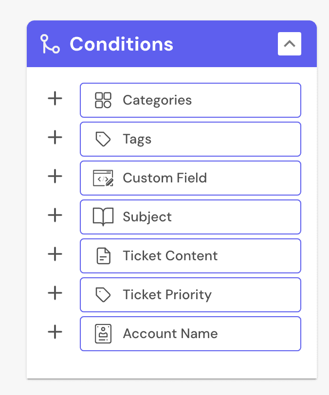
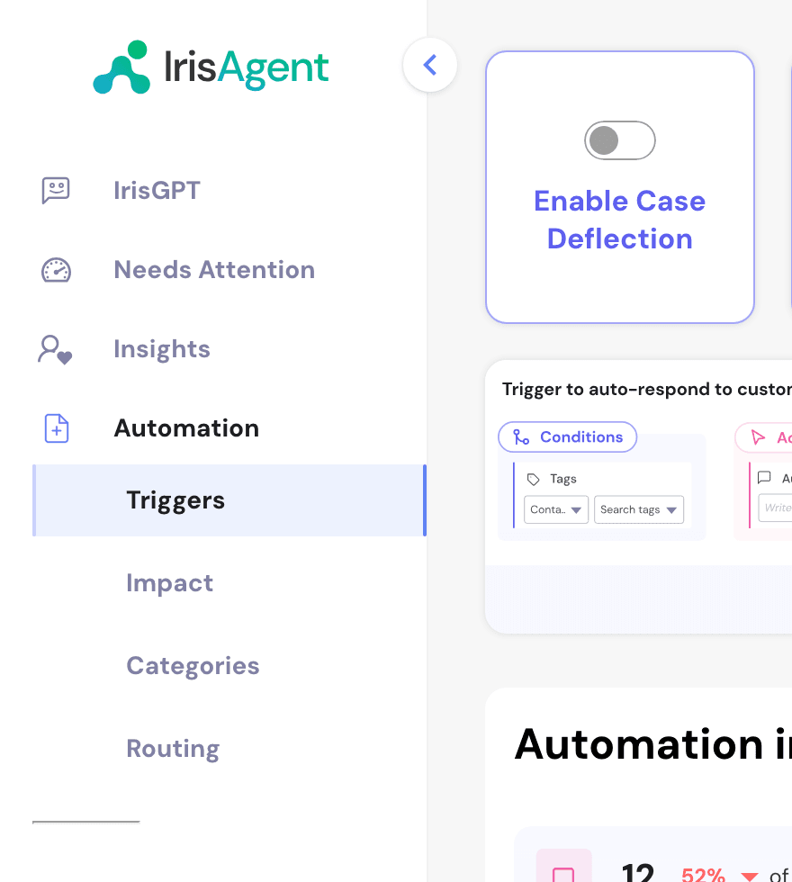

**Case Triggers** act on incoming tickets automatically. Each trigger has **Conditions** (which tickets) and **Actions** (what to do). A trigger fires only when every condition matches.

Triggers work with Zendesk, Freshdesk, Salesforce, Jira, HubSpot, Intercom, Zoho and your [Outlook](/deploying-irisagent/Outlook) inbox.

## Prerequisites

- Your ticketing system is connected. See [Connect your helpdesk](/guides/Connecting-Your-Helpdesk).
- IrisAgent has ingested enough tickets and knowledge base content to tag tickets and generate answers.
- Access to the IrisAgent dashboard. Turning on deflection for all tickets is admin-only.

## Actions

| Action | What it does |
| --- | --- |
| **Auto-respond to customer** | Sends the AI answer (the same one agents see in **Suggested Resolution**) to the customer. See [Auto-respond with AI answers](#auto-respond-with-ai-answers). |
| **Assign agent** | Routes the ticket to an agent. |
| **Assign team** | Routes the ticket to a team, for example `billing` tickets to Finance. |
| **Change case status** | Updates the ticket status. |
| **Apply Macro** | Applies one of your existing macros (Zendesk). |
| **Write tags to case** | Applies IrisAgent's AI-generated tags. |
| **Write custom tags to case** | Applies tags you define. |
| **Write custom field to case** | Writes a value to a custom field. |
| **Create Private Note** | Posts an internal note for your team. A safe first step for AI answers: agents review and send. |

<Note>
To add AI insights as a private note on every ticket without a trigger, see [Workflows](/configuring-ai-and-automation/Workflows).
</Note>

## Conditions

| Condition | Matches |
| --- | --- |
| Topics | The topic IrisAgent's AI assigns |
| Tags | Tags on the ticket |
| Custom Field | A custom field value |
| Subject | Text in the subject |
| Ticket Content | Text in the body |
| Ticket Priority | The priority |
| Account Name | The ticket's account |
| `API: <your_api_name>` | Live data from your systems, once [Custom APIs](/data-sources/Custom-API) are set up (for example, whether the customer has an active subscription) |

## Create a trigger

1. Go to **Automate → Case Triggers** on the [IrisAgent dashboard](https://web.irisagent.com/triggers) and click **Create New Trigger**.
2. Click **Add conditions** and pick conditions from the **Conditions** panel.
3. Add actions from the **Actions** panel.
4. Name the trigger with the pencil icon.
5. Click **Add New Trigger**. It runs on new tickets right away.

The trigger's **Trigger Activity** panel shows how many cases were auto-responded, auto-assigned or had their status auto-updated, for the date range you choose.

<Tip>
Start narrow (for example, one topic plus one keyword) and review the first few tickets before broadening the rule.
</Tip>

## Auto-respond with AI answers

Auto-responding (deflection) replies to tickets with IrisAgent's AI answer, built from your knowledge base and past tickets.

### On specific tickets (recommended)

1. Go to **Automate → Case Triggers** and click **Create New Trigger**.
2. Add conditions, such as a tag or keywords.

3. Add the **Auto-respond to customer** action and put `{{irisgpt.case.answer}}` in the text box. You can add text before or after it.
4. Name the trigger and click **Add New Trigger**.

The trigger's activity view lists every ticket that got an AI response.

### On all tickets

<Warning>
Every ticket with an AI answer gets an auto-response. Only do this after validating answer quality across your queue.
</Warning>

In **Automate → Case Triggers**, turn on the **Case Deflection** toggle. Turn it off the same way.

This creates a trigger named **System: Case Deflection using AI**. Open it to see which tickets got AI responses.

## Example uses

- **Known issues:** send the AI answer, or post it as a private note for review.
- **Routing:** send `billing` topics to Finance, or "cancel my subscription" to retention.
- **Auto-tagging:** tag `refund` or `outage` tickets for consistent reporting.
- **VIP handling:** use an API condition on customer segment to route enterprise tickets.
- **Entitlement checks:** use an API condition on subscription status to auto-respond or route to sales.

## Related pages

- [Workflows](/configuring-ai-and-automation/Workflows): drag-and-drop trigger builder, procedures and the AI insights private note.
- [Custom APIs](/data-sources/Custom-API): set up APIs for API conditions.
- [Outlook](/deploying-irisagent/Outlook): how triggers work for email.

Need help? [Email us](mailto:contact@irisagent.com).
