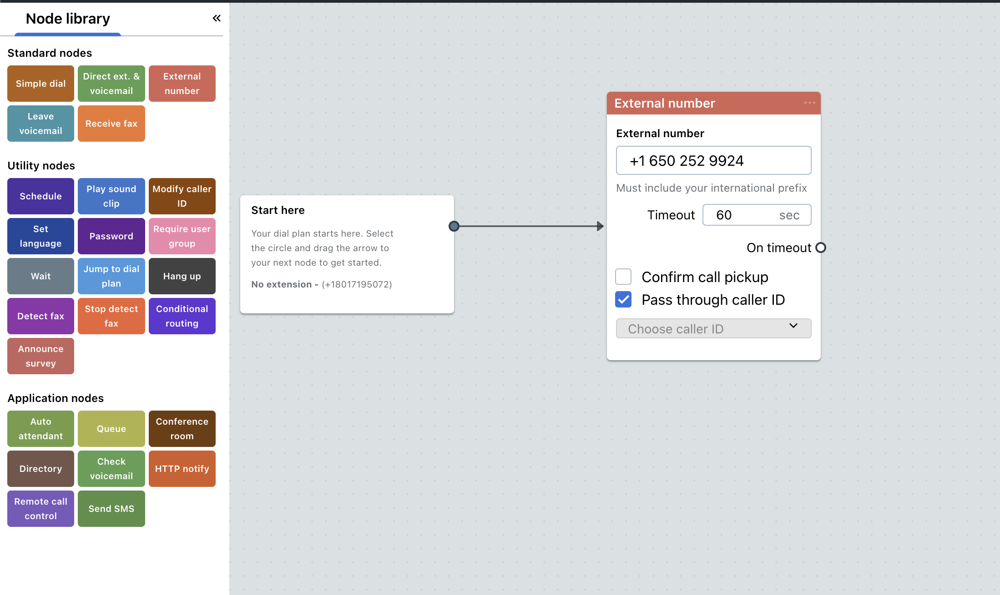

## Prerequisites

- A GoTo Connect account with admin or super admin access
- Access to the GoTo Connect PBX Administration portal
- A GoTo Connect phone number that receives customer calls

## Step 1: Sign up for IrisAgent

Sign up by connecting your ticketing platform or by using your public website as the knowledge source.

## Step 2: Create a dial plan in GoTo Connect

1. Sign in to the GoTo Connect Admin Portal.
2. Go to **Phone System → Dial Plans** and click **\+ Add Dial Plan**.
3. Name the dial plan (for example, "IrisAgent Voice AI").
4. Add a node that routes calls to an external number, and enter the **external phone number** from the IrisAgent team.

   
5. Optionally, set business hours (to use AI only at certain times) and fallback options (if the external number is unavailable).
6. Click **Save**.

## Step 3: Test

1. Call your number from an outside phone (not a GoTo Connect line).
2. You should hear the IrisAgent Voice AI greeting.
3. Try a few common customer questions to check the responses.
