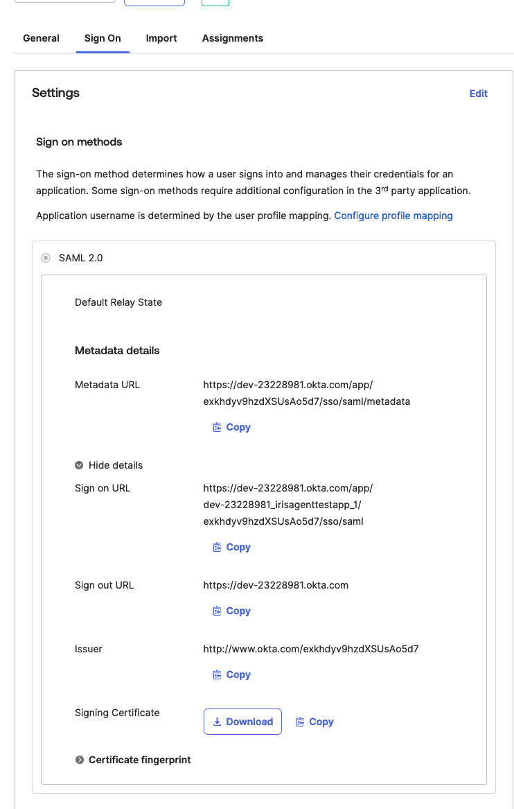

IrisAgent supports SAML sign-in with Okta.

## Step 1: Create a SAML app in Okta

1. Create a SAML app using [Okta's guide](https://help.okta.com/oie/en-us/content/topics/apps/apps_app_integration_wizard_saml.htm).
2. Get your `TENANT_ID` from your IrisAgent point of contact, then set:
   - **Single sign-on URL**: `https://frontend-api-server-v2.api.irisagent.com/oauth/okta/TENANT_ID/saml/acs`
   - **Audience URI (SP Entity ID)**: `https://frontend-api-server-v2.api.irisagent.com/oauth/okta/TENANT_ID/saml/metadata`
   - **Attribute Statements**:
     - `email`: `user.email`
     - `name`: `user.firstName + " " + user.lastName`

## Step 2: Send the metadata to IrisAgent

Send your IrisAgent contact the app's **Metadata URL** and **Issuer**.

## Step 3: Connect your ticketing system

A user with `write` access in your ticketing system (for example, [Zendesk](/data-sources/Zendesk)) connects it to IrisAgent. Make sure this user is assigned to the IrisAgent SAML app in Okta.

## Step 4: Notify IrisAgent

[Email us](mailto:contact@irisagent.com) once the metadata is sent and the ticketing system is connected.

## Step 5: Sign in

After IrisAgent confirms your account is ready, sign in from the **My Apps** page of your Okta dashboard.

## Step 6: Add more users

Assign users to the IrisAgent SAML app in Okta, and also add them on the **Manage Users** page of the [IrisAgent Dashboard](https://web.irisagent.com/).
