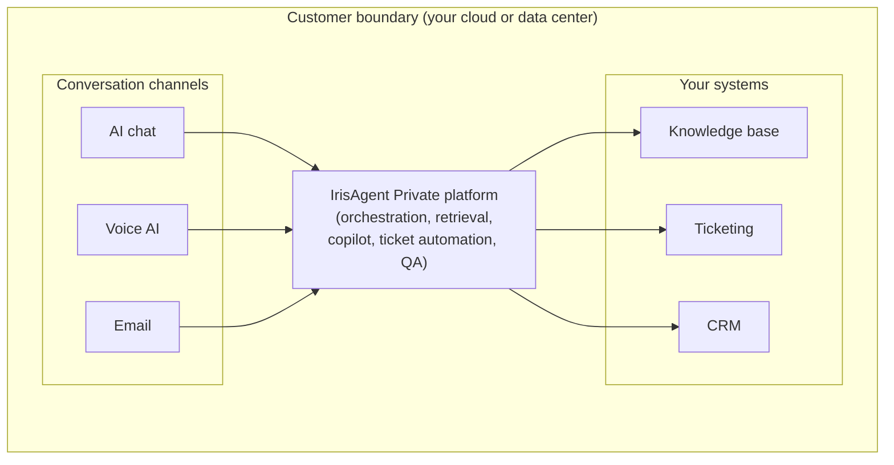

IrisAgent Private is the full IrisAgent platform (AI chat, voice AI, email, agent assist and copilot, ticket automation, and auto QA) deployed in your own data center or cloud account. It is software only. There is no hardware appliance to rack, ship, or maintain.

Every conversation, knowledge base retrieval, model inference call, and audit log stays inside your network boundary. It is the same orchestration, retrieval, ticket automation, and QA as the cloud product.

## Deployment modes

All three modes keep customer conversation data inside your boundary.

| Mode | Where it runs | Network egress | Best for |
| --- | --- | --- | --- |
| Customer VPC (private cloud) | Your own AWS, Azure, or GCP account, inside your VPC or tenant | None to public model APIs or IrisAgent cloud; optional private links to your own systems | Teams on a cloud provider that want data sovereignty without managing servers |
| On-premise data center | Your own servers behind your firewall | Controlled outbound only, through your change-control and egress policies | Regulated organizations that need data in a named facility |
| Air-gapped | Your own servers with no outbound internet | Zero outbound network calls | The most sensitive environments: defense, critical infrastructure, isolated enclaves |

## Core principles

- **Zero data egress.** Conversations, retrieval, inference, and logging stay inside your boundary. No conversation data goes to IrisAgent cloud or any external model API.
- **Data sovereignty.** Data stays in the region, account, or facility you choose.
- **Audit readiness.** Every action is recorded in an audit trail you own and can share with examiners, auditors, or compliance teams.
- **Private or bring-your-own models.** Use privately hosted model weights, or your own model endpoint in your tenant. No public model APIs are required.
- **Role-based access.** Access is governed by your identity provider with RBAC, and every interaction is logged.

## Compliance

IrisAgent is built and operated in alignment with SOC 2 Type II, HIPAA, GDPR, CCPA, and PCI DSS. IrisAgent Private extends these controls into your environment, where you control data residency, access, and retention.

## Platform inside your boundary

Your channels connect on one side, and your knowledge, ticketing, and CRM systems on the other. Everything stays inside the boundary.

## Next steps

- [Reference Architecture: Customer Cloud (VPC)](/security-and-compliance/Reference-Architecture-Customer-VPC): deploying into your own cloud account
- [Reference Architecture: On-Premise and Air-Gapped](/security-and-compliance/Reference-Architecture-On-Prem-Air-Gapped): deploying into your own data center, including fully air-gapped

[Email us](mailto:contact@irisagent.com) to scope an IrisAgent Private deployment.
