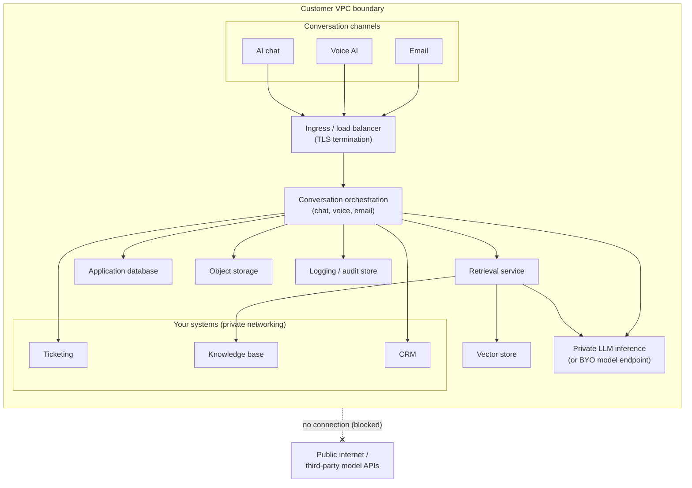

IrisAgent Private runs in your own cloud account (AWS, Azure, or GCP), inside your VPC or tenant. Everything that touches customer conversation data runs inside that boundary, including a privately hosted model.

<Note>
  No customer conversation data leaves your VPC, and there are no calls to public model APIs. Inference, embeddings, retrieval, and logging all run inside the boundary. Connections to your ticketing, CRM, and knowledge systems stay on your network or use private networking (private link, peering, or service endpoints), never the public internet.
</Note>

## Components

All of these run inside your VPC or tenant:

| Component | Role |
| --- | --- |
| Ingress and load balancer | Terminates TLS and routes channel traffic to the app |
| IrisAgent application services | Conversation orchestration (chat, voice, email), retrieval, agent copilot, ticket automation, QA |
| Model inference service | A private LLM in your tenant, or your own model endpoint in the tenant |
| Vector store | Embeddings for knowledge base retrieval |
| Application database | Configuration, conversation state, metadata |
| Object storage | Documents, attachments, model artifacts |
| Logging and audit store | The full audit trail, in your account |

## Deployment flow

<Steps>
  <Step title="Provision in your tenant">
    Install the stack in the cloud account, region, and VPC you choose. Nothing runs in IrisAgent cloud.
  </Step>
  <Step title="Connect data sources over private networking">
    Connect ticketing, CRM, and knowledge systems with private link, VPC peering, or service endpoints.
  </Step>
  <Step title="Deploy via your IAM">
    Deploy and operate with your own identity and access management. You control roles, permissions, and keys.
  </Step>
  <Step title="Tune">
    Configure conversation behavior, retrieval, response style, and QA rules. Validate on your own knowledge and ticket data.
  </Step>
  <Step title="Go live in days">
    Route chat, voice, and email to the deployment. Go live typically in days rather than months.
  </Step>
</Steps>

## Keys and encryption

- **Customer-managed keys (KMS).** You hold and rotate the encryption keys. IrisAgent never has access to them.
- **TLS in transit** between channels, services, and datastores.
- **Encryption at rest** with your keys for the database, vector store, object storage, and audit store.

## Data flow: zero egress

Every component is inside the boundary. The public internet and third-party model APIs are outside it, with no connection.

## Next steps

- Own data center or air-gapped enclave: [Reference Architecture: On-Premise and Air-Gapped](/security-and-compliance/Reference-Architecture-On-Prem-Air-Gapped)
- Deployment mode comparison: [IrisAgent Private: Deployment Overview](/security-and-compliance/Private-Deployment-Overview)

[Email us](mailto:contact@irisagent.com) to scope a customer-cloud deployment.
