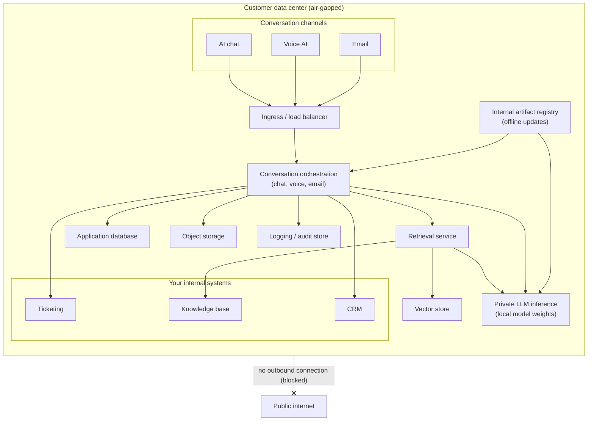

IrisAgent Private can run on your own servers, behind your firewall, including a fully air-gapped variant with no outbound internet. The components match the [customer-cloud architecture](/security-and-compliance/Reference-Architecture-Customer-VPC). The only difference is that everything runs in your data center instead of a cloud account.

<Note>
  In air-gapped mode there are zero outbound network calls. All inference and logging stay in your data center. Private model weights are installed directly, and updates arrive through your own change control (for example an internal artifact registry), never through live calls to the public internet.
</Note>

## Components

All run on your servers, behind your firewall:

- **Ingress and load balancer:** routes channel traffic to the app, with TLS terminated inside your network.
- **IrisAgent application services:** conversation orchestration for chat, voice, and email, retrieval, agent copilot, ticket automation, and QA.
- **Model inference service:** runs private model weights installed locally. No external model API is contacted.
- **Vector store:** embeddings for retrieval over your knowledge base.
- **Application database, object storage, and audit store:** configuration, conversation state, artifacts, and the full audit trail.

Connections to your ticketing, CRM, and knowledge base systems stay inside your network.

## Install flow

1. **Install** the IrisAgent Private stack on servers in your data center.
2. **Load private models** shipped with the deployment. No internet download is needed.
3. **Connect** your internal ticketing, knowledge base, and CRM over your internal network.
4. **Configure SSO and RBAC** with your identity provider. See [Single Sign On (SSO) Options](/security-and-compliance/Single-Sign-On-Options).
5. **Validate** conversations, retrieval, and QA against your own data.
6. **Go live** by routing chat, voice, and email to the deployment.

## Updates

Model and software updates are packaged and delivered through your change-control process, such as an internal artifact registry or an approved offline transfer. Your team reviews and promotes each update on your schedule.

## Keys and encryption

- **Customer-managed keys:** held and rotated in your environment. IrisAgent has no access to them.
- **TLS in transit:** between channels, services, and datastores inside your network.
- **Encryption at rest:** all datastores, with your keys.

## Data flow: zero egress

Every component sits inside the data center boundary. Nothing crosses to the public internet.

## Next steps

- Deploying to your own cloud account instead: [Reference Architecture: Customer Cloud (VPC)](/security-and-compliance/Reference-Architecture-Customer-VPC)
- Comparing deployment modes: [IrisAgent Private: Deployment Overview](/security-and-compliance/Private-Deployment-Overview)

[Email us](mailto:contact@irisagent.com) to scope an on-premise or air-gapped deployment.
